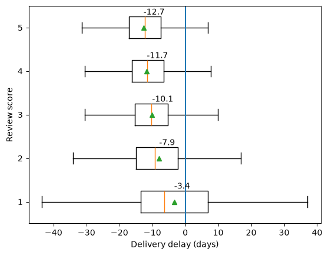
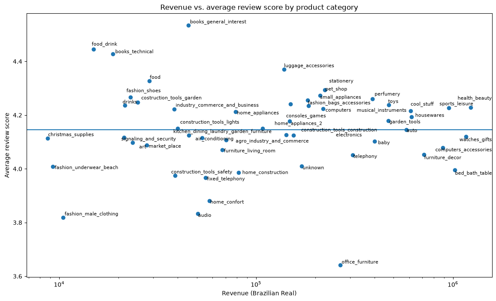
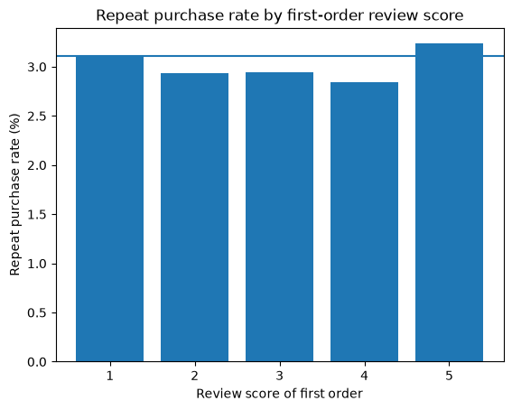
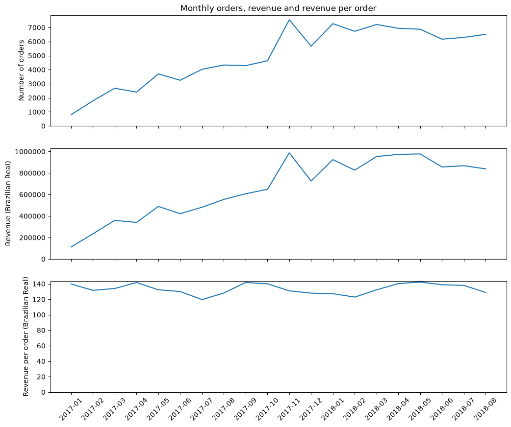

# Olist E-Commerce Analysis (SQL & Python)

This will be an analysis of around 100,000 orders from Olist, a Brazilian e-commerce marketplace, covering delivery performance, customer satisfaction, customer retention and revenue growth.

## Data

The [Brazilian E-Commerce Public Dataset by Olist](https://www.kaggle.com/datasets/olistbr/brazilian-ecommerce) consists of 9 CSV files (orders, customers, order items, reviews, payments, products, sellers, geolocation and a category name translation table). The CSV files are not included in this repository; to run the code, download them from Kaggle and place them in a folder called `Olist Datasets`.

## Method

Each CSV file is loaded into a SQLite database as its own table, and the questions below are answered with the use of SQL queries, followed by analysis in pandas, regressions and visualizations.

To explore the data, the relationships between the tables were determined first. Join keys usually have the same names in different tables, so the column names that appear in more than one table were found using a function. This gave `seller_id`, `product_category_name`, `product_id`, `order_id` and `customer_id`, which all seem to be join keys. Looking through the column names also shows `customer_unique_id`, which is a join key as well, albeit not duplicated in any other table: `customer_unique_id` identifies the customer, while `customer_id` identifies the order.

Based on the data, there are many different questions that can be answered. I focused on 4:

1. Does a delay in the time it takes to deliver an order correlate with its review score?
2. What is the average review score for each product category, and what revenue does each yield?
3. Does a customer's experience with an order correlate with whether they would make a repeat purchase?
4. What is the earned revenue, and how many orders do customers place, in each month?

If correlations are found, an underlying causal relationship may exist, which can be further investigated through experimentation.

## Findings

### 3.1 Delivery delay and review score

Delivery delay is measured as the number of days between the actual and the estimated delivery date (negative values mean the order arrived early). Since there is an ordinal variable (review score) and a continuous variable (delay), a box plot is used:



The plot shows a clear negative correlation between the delivery delay and the review score. Based on a regression, each extra day of delivery is associated with a 0.0338 lower review score on average, which is a decrease of roughly 1 star for each extra month of delivery time. An R-squared of around 0.071 shows that delivery timing explains around 7% of the variation in review scores, so most of the variation is explained by other factors, for example product quality or perhaps customer expectations.

### 3.2 Revenue and average review score by product category

Only delivered orders are included, since undelivered orders are refunded and generate no revenue; the average review scores therefore reflect satisfaction for delivered orders only. Revenue is calculated with each item counted only once, and the average review with each order's review counted only once per category. Only categories with at least 100 orders are plotted, so the averages are reliable. Since revenue is skewed, it is shown on a log scale. The horizontal line shows the overall average review score.



A regression of the average review score on revenue shows that the revenue generated by product categories has almost no association with review scores: an R-squared of around 0.00005 shows that revenue explains almost none of the variation in category ratings.

### 3.3 Customer experience and repeat purchases

Unlike in 3.2, both delivered and undelivered orders are included, since customers can order items that do not get delivered in repeat purchases, and because an undelivered order would be a part of a customer's order experience. For each customer, the first order is found, and it is then checked whether the customer ever ordered again. Customers whose first order has no review cannot be grouped by review score, so they are therefore excluded.



Only around 3.11% of customers reordered after their first order, and the bar chart shows no correlation between review scores and the repeat rate. Since whether a customer reordered is binary, a logistic regression is used to quantify this. An odds ratio of 1.017 means that for every additional star in the review score, the odds of a repeat order increase by only 1.7%, and a pseudo R-squared of around 0.00006 shows that the review score explains almost none of the variation in whether customers make a repeat order.

### 3.4 Monthly orders and revenue

Instead of selecting only delivered orders, a `CASE WHEN` is used, so that the orders that have not been delivered are included in the order count but do not count towards revenue. 2016 is excluded, as it has very few orders and no entry for November 2016. September and October 2018 are also excluded, since none of their orders were delivered (19 were canceled and 1 had been shipped but not yet delivered), so they have no revenue.



The number of orders and revenue increase from January 2017 to November 2017, and beyond November 2017 both remain more or less constant. Revenue per order stays roughly similar throughout (between 120 and 142 BRL), so the growth in revenue has mostly come from an increase in the number of orders rather than an increase in the revenue per order. Revenue per order divides delivered revenue by all orders placed, so it slightly understates the value of a delivered order.

In November 2017, orders increased by around 63% compared to October, whereas revenue per order decreased from 140 BRL to 131 BRL. This could be because Black Friday occurs in November, when products go on discount and more of them are usually bought.

## Conclusions

From 3.1: Delivery timing has a modest correlation with customer satisfaction, which could be indicative of a causal relationship between the two.

From 3.2: Customer satisfaction (as measured through review scores) differs by product category, but does not correlate with category revenue.

From 3.3: Customer satisfaction does not, however, seem to correlate with customer retention (as measured by the repeat purchase rate). Only around 3% of customers reorder in the first place, and this rate is around the same regardless of the review score of their first orders.

From 3.4: Although revenue has increased more than sevenfold between January 2017 and August 2018, that increase is more so attributable to increasing order quantity rather than a change in the revenue per order.

Taken together, growth has come almost entirely from new customers, while almost no customers return, and better experiences do not appear to change that. Customer retention could therefore be an untapped opportunity.

All of the findings are correlational, and the existence of causal relationships would have to be confirmed through experimentation.

## Running the code

Requirements: Python 3 with `pandas`, `numpy`, `matplotlib`, `scipy`, `statsmodels` and `adjustText`.

```
pip install pandas numpy matplotlib scipy statsmodels adjustText
python olist_data_project.py
```

The script builds the SQLite database, prints the results and saves the four charts as PNG files.
